<div align="center">

# 🏥 Philips Product Knowledge AI Agent

### Enterprise-Grade Multi-Agent RAG System for Grounded Product Documentation Q&A

*Zero hallucination. Full traceability. Production-ready.*

[](https://www.python.org/)
[](https://fastapi.tiangolo.com/)
[](https://langchain-ai.github.io/langgraph/)
[](https://github.com/facebookresearch/faiss)
[](https://huggingface.co/)
[](https://huggingface.co/Qwen)

[]()
[]()
[]()
[]()
[]()

<br/>

**A production-ready Retrieval-Augmented Generation system that answers questions strictly from Philips product manuals — never from parametric knowledge.**

[Overview](#-overview) •
[Architecture](#-system-architecture) •
[Installation](#-installation) •
[API Reference](#-api-endpoints) •
[Testing](#-testing) •
[Roadmap](#-future-improvements)

</div>

---

## 📖 Table of Contents

- [Overview](#-overview)
- [Why This Project](#-why-this-project)
- [Features](#-features)
- [System Architecture](#-system-architecture)
- [Multi-Agent Design](#-multi-agent-design)
- [LangGraph Workflow](#-langgraph-workflow)
- [Data Flow Sequence](#-data-flow-sequence)
- [Confidence Decision Logic](#-confidence-decision-logic)
- [Security Architecture](#-security-architecture)
- [Folder Structure](#-folder-structure)
- [Installation](#-installation)
- [Configuration](#-configuration)
- [Running the Application](#-running-the-application)
- [Building the Vector Database](#-building-the-vector-database)
- [Ingestion Pipeline](#-ingestion-pipeline-flow)
- [Using the UI](#-using-the-ui)
- [API Endpoints](#-api-endpoints)
- [Request Lifecycle](#-request-lifecycle-state-diagram)
- [Testing](#-testing)
- [Troubleshooting](#-troubleshooting)
- [Logging & Observability](#-logging--observability)
- [Security Features](#-security-features)
- [Deployment Topology](#-deployment-topology)
- [Future Improvements](#-future-improvements)
- [Contributing](#-contributing)
- [License](#-license)

---

## 🔎 Overview

The **Philips Product Knowledge AI Agent** is an enterprise-grade **Retrieval-Augmented Generation (RAG)** system purpose-built to answer user questions **strictly from uploaded Philips product manuals**.

Unlike a conventional chatbot, this agent **never relies on parametric (model-internal) knowledge**. Every response is:

- ✅ Grounded in retrieved documentation
- ✅ Backed by source citations and page numbers
- ✅ Accompanied by retrieved chunks for transparency
- ✅ Scored with a confidence rating before being served

The system showcases a modern **Multi-Agent AI architecture** orchestrated with **LangGraph**, making it a strong reference implementation for enterprise AI applications and technical portfolios.

> **💡 Design Philosophy**
> If the answer isn't in the documents, the agent refuses to answer rather than hallucinate. Grounding is enforced at multiple pipeline stages, not just prompted for.

---

## 🎯 Why This Project

| Traditional Chatbot | Philips Product Knowledge AI Agent |
|---|---|
| Relies on LLM's internal (parametric) knowledge | Strictly grounded in retrieved documents |
| No citation of sources | Every answer includes document, page, and chunk citations |
| Vulnerable to prompt injection | Dedicated Security Agent for injection/jailbreak detection |
| Single monolithic prompt | Multi-agent pipeline with specialized responsibilities |
| No confidence signaling | Confidence-based decision making with refusal logic |
| Difficult to audit | Full structured logging with node execution trace |

---

## ✨ Features

<table>
<tr>
<td width="50%" valign="top">

**Core Architecture**
- Multi-Agent Architecture using LangGraph
- Enterprise RAG Pipeline
- Modular Clean Architecture
- Dependency Injection
- FastAPI Backend

**Document Processing**
- PDF Document Ingestion
- Semantic Chunking
- BAAI/bge-base-en-v1.5 Embeddings
- FAISS Vector Database

</td>
<td width="50%" valign="top">

**Safety & Trust**
- Prompt Injection Detection
- Jailbreak Prevention
- Hallucination Prevention
- Confidence-Based Decision Making
- Source Citations & Page Number References

**Operations**
- Qwen2.5-7B/OpenAI(Optional) LLM
- Structured Logging
- Bootstrap Chat Interface
- Comprehensive Unit Tests

</td>
</tr>
</table>

---

## 🏗 System Architecture

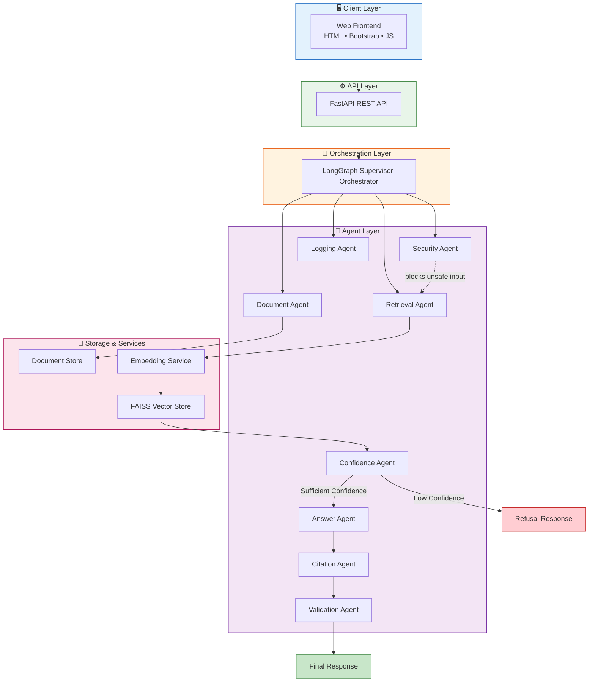

---

## 🧩 Multi-Agent Design

Each agent has a **single, well-defined responsibility**, following the separation-of-concerns principle used in enterprise microservice design.

```mermaid
graph LR
    A["1️⃣ Supervisor Orchestrator<br/>Entry point & routing"] --> B["2️⃣ Security Agent<br/>Injection & jailbreak detection"]
    B --> C["3️⃣ Document Agent<br/>Verify documents & DB"]
    C --> D["4️⃣ Retrieval Agent<br/>FAISS search & Top-K"]
    D --> E["5️⃣ Confidence Agent<br/>Score & gate decision"]
    E --> F["6️⃣ Answer Agent<br/>Grounded generation"]
    F --> G["7️⃣ Citation Agent<br/>Sources & page numbers"]
    G --> H["8️⃣ Validation Agent<br/>Grounding verification"]

    style A fill:#fff3e0,stroke:#e65100,stroke-width:2px
    style B fill:#ffebee,stroke:#c62828,stroke-width:2px
    style C fill:#e8f5e9,stroke:#2e7d32,stroke-width:2px
    style D fill:#e3f2fd,stroke:#1565c0,stroke-width:2px
    style E fill:#fff9c4,stroke:#f57f17,stroke-width:2px
    style F fill:#f3e5f5,stroke:#6a1b9a,stroke-width:2px
    style G fill:#e0f2f1,stroke:#00695c,stroke-width:2px
    style H fill:#fce4ec,stroke:#ad1457,stroke-width:2px
```

### Agent Responsibility Matrix

| # | Agent | Primary Responsibility | Key Outputs |
|---|---|---|---|
| 1 | **Supervisor Orchestrator** | Entry point, execution routing, state management, conditional branching | Workflow control signals |
| 2 | **Security Agent** | Prompt injection detection, jailbreak detection, sanitization, unsafe request blocking | Sanitized query / block signal |
| 3 | **Document Agent** | Verify uploaded documents, FAISS DB integrity, metadata validity | Availability status |
| 4 | **Retrieval Agent** | Generate query embeddings, FAISS search, Top-5 retrieval, deduplication, similarity thresholding | Retrieved chunks |
| 5 | **Confidence Agent** | Evaluate retrieval quality, compute confidence score, gate generation | Confidence score + decision |
| 6 | **Answer Agent** | Build context, construct prompt, generate grounded response | Draft answer |
| 7 | **Citation Agent** | Attach document names, page numbers, chunk IDs, similarity scores | Cited answer |
| 8 | **Validation Agent** | Verify grounding, ensure citations exist, prevent hallucination, validate confidence | Final validated response |

<details>
<summary><strong>🔐 Security Agent — Blocked Request Examples</strong></summary>

The Security Agent actively detects and blocks adversarial prompts, including:

- Instructions attempting to override system behavior (e.g., "ignore previous instructions")
- Attempts to expose internal system prompts
- Attempts to impersonate a different AI system
- Attempts to trigger destructive operations on the vector database
- Requests to answer from general internet knowledge instead of the document store
- Requests to fabricate or invent information not present in the source documents

</details>

---

## 🔄 LangGraph Workflow


> **⚠️ Warning**
> If retrieval confidence falls below `SIMILARITY_THRESHOLD`, the workflow short-circuits directly to a refusal response — the LLM generation stage is never invoked. This prevents hallucinated answers from ever reaching the user.

---

## 🔁 Data Flow Sequence

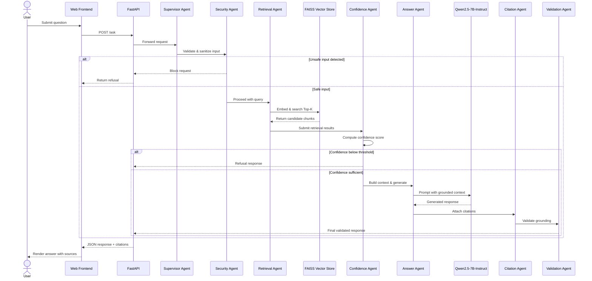

---

## 🎚 Confidence Decision Logic

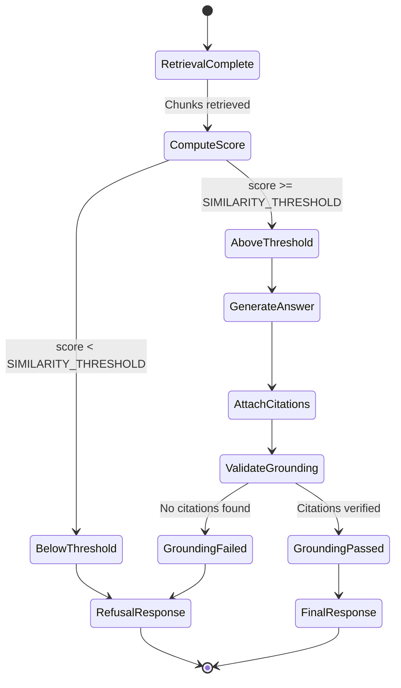

---

## 🔐 Security Architecture

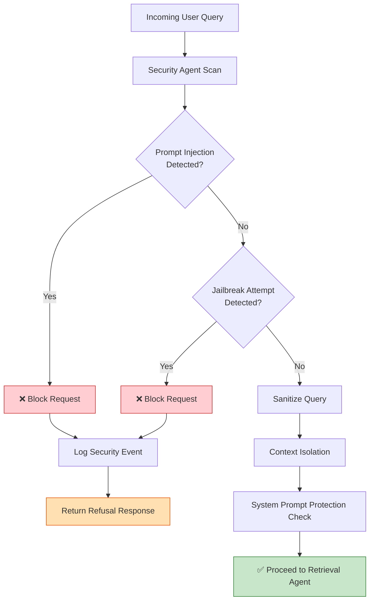

> **📝 Note**
> Security scanning happens **before** document availability checks and retrieval — no query reaches the vector store without first passing injection and jailbreak detection.

---

## 📁 Folder Structure

```text
product-ai-agent/
│
├── app/
│   ├── agent/
│   │   ├── graph/          # LangGraph graph definitions
│   │   ├── nodes/          # Individual agent node implementations
│   │   ├── routers/        # Conditional routing logic
│   │   ├── state/          # Shared state schemas
│   │   └── tools/          # Agent tool implementations
│   │
│   ├── api/                # FastAPI route definitions
│   ├── ingestion/          # PDF parsing & chunking pipeline
│   ├── retrieval/          # FAISS retrieval logic
│   ├── vectorstore/        # Vector store management
│   ├── llm/                # LLM client & inference wrappers
│   ├── prompts/            # Prompt templates
│   ├── services/           # Business logic services
│   ├── models/             # Pydantic / data models
│   ├── utils/               # Shared utilities
│
├── data/                   # Uploaded documents & vector DB
├── static/                 # Static frontend assets
├── templates/               # Jinja2/HTML templates
├── logs/                   # Structured application logs
├── tests/                  # Unit & integration tests
│
├── main.py                 # Application entry point
├── requirements.txt        # Python dependencies
└── README.md
```

---

## ⚙️ Installation

### 1️⃣ Clone Repository

```bash
git clone <repository_url>
cd product-ai-agent
```

### 2️⃣ Create Virtual Environment

<details>
<summary><strong>🪟 Windows</strong></summary>

```powershell
python -m venv .venv
.venv\Scripts\activate
```

</details>

<details>
<summary><strong>🐧 Linux / macOS</strong></summary>

```bash
python3 -m venv .venv
source .venv/bin/activate
```

</details>

### 3️⃣ Install Dependencies

```bash
pip install -r requirements.txt
```

---

## 🔧 Configuration

Create a `.env` file in the project root:

```dotenv
APP_NAME=Philips Product Knowledge AI Agent

LOG_LEVEL=INFO

EMBEDDING_MODEL=BAAI/bge-base-en-v1.5
LLM_MODEL=Qwen/Qwen2.5-7B

VECTOR_DB=data/vector_db
DATA_DIRECTORY=data/users

TOP_K=5
SIMILARITY_THRESHOLD=0.75
MAX_CONTEXT_CHUNKS=5

DEVICE=cpu
```

### Configuration Reference

| Variable | Description | Default |
|---|---|---|
| `APP_NAME` | Display name of the application | `Philips Product Knowledge AI Agent` |
| `LOG_LEVEL` | Logging verbosity | `INFO` |
| `EMBEDDING_MODEL` | HuggingFace embedding model identifier | `BAAI/bge-base-en-v1.5` |
| `LLM_MODEL` | LLM used for answer generation | `Qwen/Qwen2.5-7B` |
| `VECTOR_DB` | Path to persisted FAISS index | `data/vector_db` |
| `DATA_DIRECTORY` | Directory for uploaded source PDFs | `data/users` |
| `TOP_K` | Number of chunks retrieved per query | `5` |
| `SIMILARITY_THRESHOLD` | Minimum similarity score to proceed with generation | `0.50` |
| `MAX_CONTEXT_CHUNKS` | Maximum chunks passed into LLM context | `5` |
| `DEVICE` | Inference device (`cpu` or `cuda`) | `cpu` |

> **💡 Tip**
> Lower `SIMILARITY_THRESHOLD` cautiously — reducing it increases recall but also increases the risk of low-quality or loosely related context being passed to the LLM.

---

## 🚀 Running the Application

Start the backend server:

```bash
uvicorn main:app --reload
```

| Resource | URL |
|---|---|
| Web Interface | `http://127.0.0.1:8000` |
| Swagger UI (API Docs) | `http://127.0.0.1:8000/docs` |

---

## 🗃 Building the Vector Database

### Step 1 — Add Source Documents

Place Philips product manuals (PDF) into:

```text
data/users/
```

### Step 2 — Run Ingestion Pipeline

```bash
python build_vector_database.py
```

### 📥 Ingestion Pipeline Flow

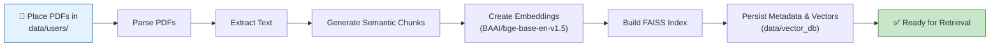

> **📝 Note**
> The ingestion pipeline must be re-run any time new documents are added or existing documents are updated — the FAISS index does not update incrementally by default.

---

## 🖥 Using the UI

Once the FastAPI server is running, navigate to `http://127.0.0.1:8000` to access:

| Component | Description |
|---|---|
| 📤 **PDF Upload** | Upload new Philips product manuals directly through the browser |
| 💬 **Chat Window** | Ask natural-language questions about uploaded documentation |
| 🎯 **Confidence Badge** | Visual indicator of the system's confidence in each answer |
| 📚 **Source Panel** | Displays cited documents, page numbers, and retrieved chunks |
| 🕘 **Conversation History** | Maintains a record of prior questions and answers |
| 📱 **Responsive Bootstrap Layout** | Fully responsive across desktop and mobile |

---

## 🔌 API Endpoints

| Method | Endpoint | Description |
|---|---|---|
| `GET` | `/` | Web Interface |
| `GET` | `/health` | Health Check |
| `POST` | `/upload` | Upload PDFs |
| `POST` | `/ask` | Ask Questions |
| `GET` | `/sources` | View Uploaded Sources |

<details>
<summary><strong>📮 Example: POST /ask</strong></summary>

```bash
curl -X POST "http://127.0.0.1:8000/ask" \
  -H "Content-Type: application/json" \
  -d '{
        "question": "What is the recommended cleaning cycle for the Philips AVENT sterilizer?"
      }'
```

**Example Response Shape:**

```json
{
  "answer": "...",
  "confidence_score": 0.87,
  "sources": [
    {
      "document": "AVENT_Sterilizer_Manual.pdf",
      "page": 14,
      "chunk_id": "chunk_0091",
      "similarity_score": 0.89
    }
  ]
}
```

</details>

---

## 🔄 Request Lifecycle State Diagram

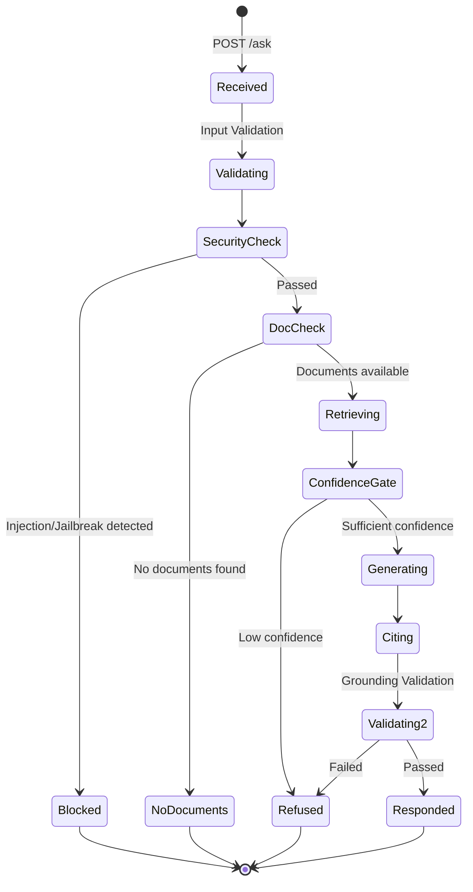

---

## 🧪 Testing

Run all tests:

```bash
pytest
```

Run with coverage:

```bash
pytest --cov=app
```

### Recommended Test Scenarios

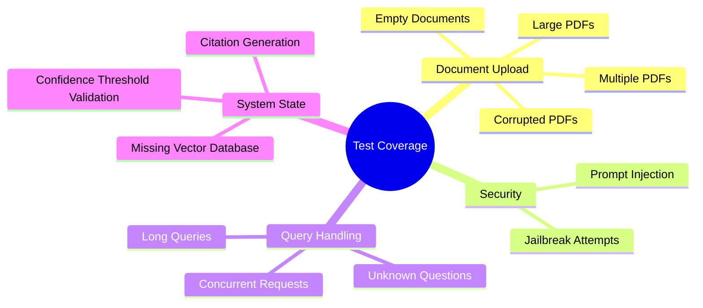

| Category | Scenario |
|---|---|
| **Upload** | Multiple PDFs, large PDFs, corrupted PDFs, empty documents |
| **Security** | Prompt injection, jailbreak attempts |
| **Query Handling** | Unknown questions, long queries, concurrent requests |
| **System State** | Missing vector database, confidence threshold validation, citation generation |

---

## 🛠 Troubleshooting

<details>
<summary><strong>❌ No documents found</strong></summary>

**Cause:** No manuals uploaded.

**Solution:**
1. Add PDFs to `data/users`
2. Rebuild the vector database

</details>

<details>
<summary><strong>❌ Vector database missing</strong></summary>

**Cause:** FAISS index not created.

**Solution:**

```bash
python build_vector_database.py
```

</details>

<details>
<summary><strong>🐢 Slow responses</strong></summary>

**Possible causes:**
- CPU inference
- Large document corpus
- Cold model startup

**Recommendations:**
- Use GPU acceleration
- Batch embedding generation
- Increase available RAM

</details>

<details>
<summary><strong>📉 Low confidence responses</strong></summary>

**Possible causes:**
- Missing information in manuals
- Poorly phrased queries
- Similarity threshold too high

**Recommendations:**
- Verify the required information exists in the uploaded documentation
- Use more specific product names and terminology
- Adjust the retrieval threshold if appropriate

</details>

> **⚠️ Warning**
> Do not lower `SIMILARITY_THRESHOLD` as a blanket fix for low-confidence responses — first verify the source documentation actually contains the answer.

---

## 📊 Logging & Observability

The application records structured logs for every request:

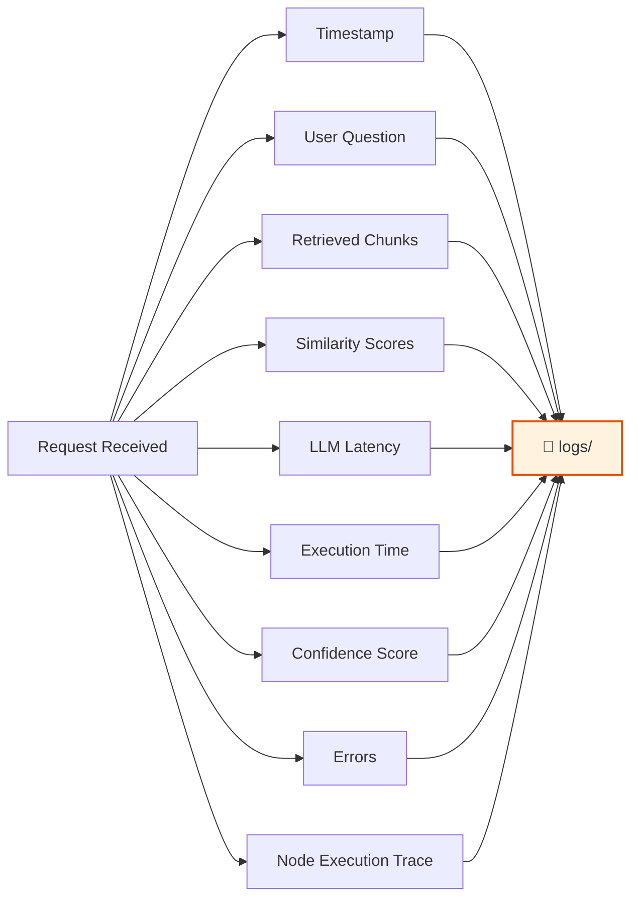

| Field | Purpose |
|---|---|
| Timestamp | Request time correlation |
| User Question | Audit trail of queries |
| Retrieved Chunks | Debugging retrieval quality |
| Similarity Scores | Confidence tuning |
| LLM Latency | Performance monitoring |
| Execution Time | End-to-end SLA tracking |
| Confidence Score | Quality assurance |
| Errors | Failure diagnostics |
| Node Execution Trace | Full LangGraph path replay |

Logs are stored under `logs/`.

---

## 🛡 Security Features

| Feature | Description |
|---|---|
| **Prompt Injection Detection** | Identifies and blocks attempts to override system instructions |
| **Jailbreak Prevention** | Detects role-play or persona-override attacks |
| **System Prompt Protection** | Prevents disclosure of internal prompt configuration |
| **Context Isolation** | Ensures user input cannot contaminate agent instructions |
| **Confidence-Based Refusal** | Automatically refuses to answer when retrieval confidence is low |
| **Strict Document Grounding** | Disallows any response not traceable to retrieved source chunks |

---

## 🌐 Deployment Topology

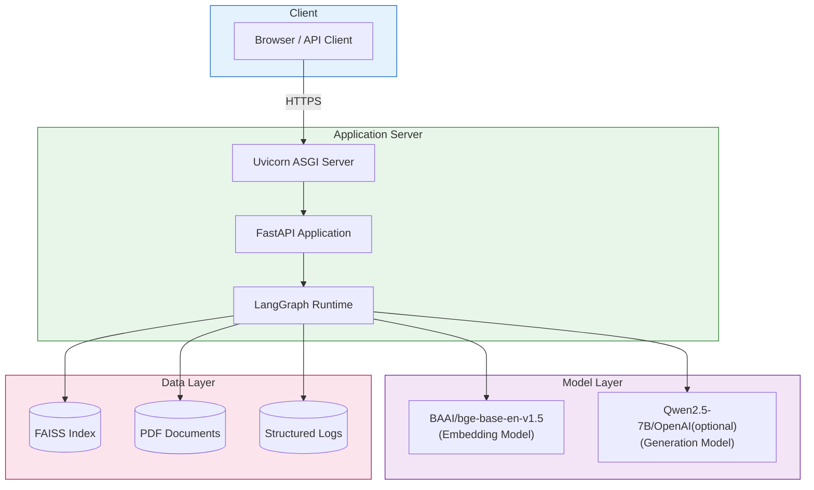

> **💡 Tip**
> For production deployments, place Uvicorn behind a reverse proxy (e.g., Nginx) with TLS termination, and consider deploying via Docker/Kubernetes as noted in the [Future Improvements](#-future-improvements) section.

---

## 🗺 Future Improvements

```mermaid
graph TD
    ROOT["🚀 Roadmap"]

    ROOT --> RETR["Retrieval Enhancements"]
    RETR --> R1["Hybrid Retrieval (BM25 + Dense)"]
    RETR --> R2["Cross-Encoder Reranking"]

    ROOT --> UX["User Experience"]
    UX --> U1["Streaming Responses"]
    UX --> U2["Multi-turn Conversation Memory"]

    ROOT --> DOC["Document Processing"]
    DOC --> D1["OCR Support for Scanned PDFs"]
    DOC --> D2["Table and Image Extraction"]
    DOC --> D3["Multi-language Document Retrieval"]
    DOC --> D4["Automatic Document Versioning"]

    ROOT --> INFRA["Infrastructure"]
    INFRA --> I1["Elasticsearch / OpenSearch Integration"]
    INFRA --> I2["Milvus, Qdrant, or Pinecone Support"]
    INFRA --> I3["Docker and Kubernetes Deployment"]
    INFRA --> I4["Distributed Workers (Celery / Ray)"]
    INFRA --> I5["Model Quantization for Faster Inference"]

    ROOT --> OPS["Operations & Governance"]
    OPS --> O1["Authentication & RBAC"]
    OPS --> O2["Monitoring with Prometheus & Grafana"]
    OPS --> O3["CI/CD Pipeline (GitHub Actions)"]
    OPS --> O4["Model Evaluation Dashboard"]

    style ROOT fill:#fff3e0,stroke:#e65100,stroke-width:3px
```

| Category | Planned Enhancement |
|---|---|
| Retrieval | Hybrid Retrieval (BM25 + Dense Retrieval) |
| Retrieval | Cross-Encoder Reranking |
| UX | Streaming Responses |
| UX | Multi-turn Conversation Memory |
| Document Processing | OCR Support for Scanned PDFs |
| Document Processing | Table and Image Extraction |
| Document Processing | Multi-language Document Retrieval |
| Document Processing | Automatic Document Versioning |
| Infrastructure | Elasticsearch or OpenSearch Integration |
| Infrastructure | Milvus, Qdrant, or Pinecone Vector Store Support |
| Infrastructure | Model Quantization for Faster Inference |
| Infrastructure | Docker and Kubernetes Deployment |
| Infrastructure | Distributed Worker Architecture with Celery or Ray |
| Operations | Authentication and Role-Based Access Control |
| Operations | Monitoring with Prometheus and Grafana |
| Operations | CI/CD Pipeline with GitHub Actions |
| Operations | Model Evaluation Dashboard |

---

## 🤝 Contributing

Contributions, issues, and feature requests are welcome!

1. Fork the repository
2. Create your feature branch (`git checkout -b feature/amazing-feature`)
3. Commit your changes (`git commit -m 'Add amazing feature'`)
4. Push to the branch (`git push origin feature/amazing-feature`)
5. Open a Pull Request

> **📝 Note**
> Please ensure all new features include corresponding unit tests under `tests/` and pass `pytest --cov=app` before submitting a PR.

---

## 📄 License

This project is intended as an **enterprise AI engineering showcase and educational reference**.

> **⚠️ Important**
> Review and comply with the licenses of all third-party models, libraries, and datasets used (including `Qwen2.5-7B`, `BAAI/bge-base-en-v1.5`, and FAISS) before deploying this system in a production environment.

---

<div align="center">

**Built with LangGraph • FastAPI • FAISS • HuggingFace • Qwen2.5**

⭐ If you find this project useful, consider starring the repository!

</div>
